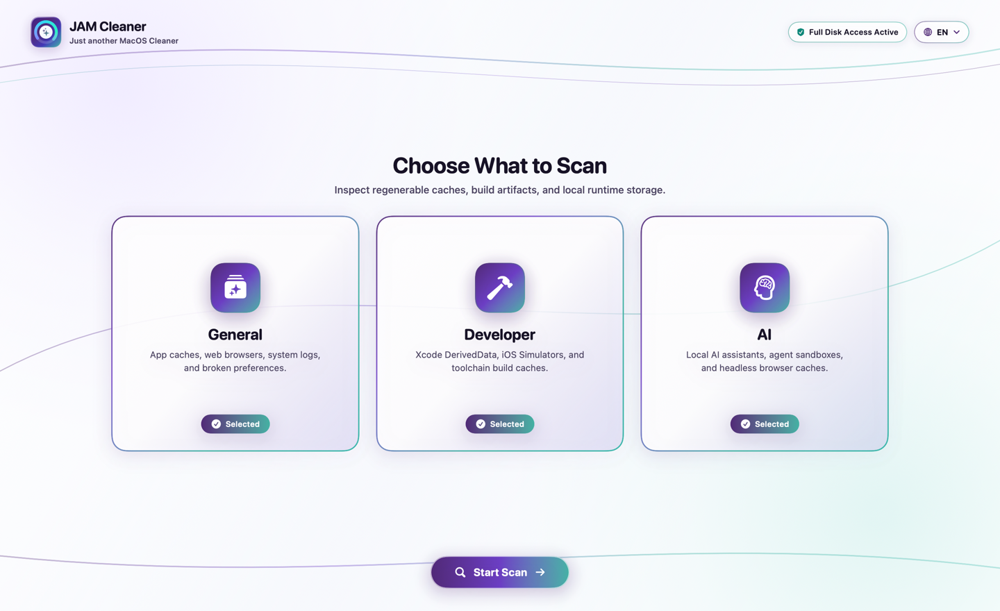
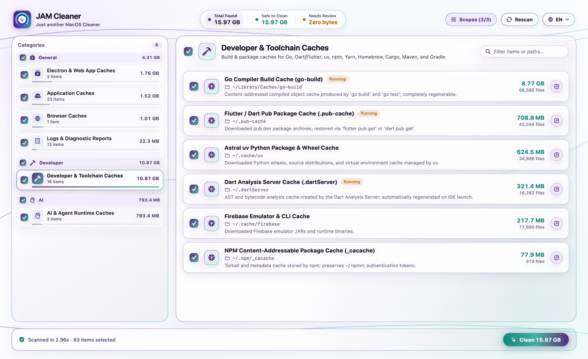
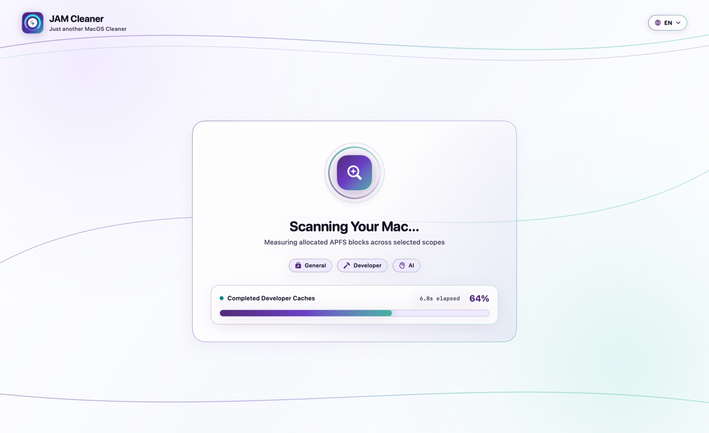
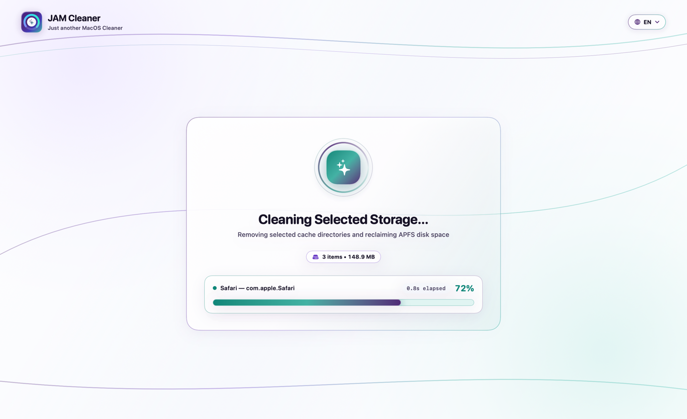
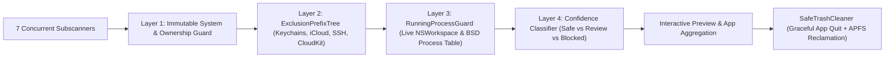

<div align="center">
  
  <h1>JAM Cleaner</h1>
  <p><strong>Just another MacOS Cleaner — Safe, transparent, zero-telemetry storage &amp; developer cache inspector for macOS.</strong></p>

  <p>
    <a href="LICENSE"></a>
    
    
    
    
  </p>

  <p>
    <a href="#why-jam-cleaner">Why JAM Cleaner?</a> ·
    <a href="#visual-tour">Visual Tour</a> ·
    <a href="#what-it-scans">What It Scans</a> ·
    <a href="#4-layer-safety-architecture">Safety Architecture</a> ·
    <a href="#quick-start">Quick Start</a> ·
    <a href="CONTRIBUTING.md">Contributing</a> ·
    <a href="SECURITY.md">Security Policy</a>
  </p>
</div>

---

## Why JAM Cleaner?

Most macOS disk cleaners require privileged root daemons, bundle background launch agents, inflate reported byte counts using logical file sizes instead of physical APFS allocation, or hide what they are actually deleting behind opaque "Smart Scan" buttons.

**JAM Cleaner** (`MacSweep`) is built from first principles as an open-source, auditable native SwiftUI application and CLI:

- **100% Unprivileged & Local**: Never asks for `sudo`/root, installs zero background launch daemons, and makes zero network requests (`Config/PrivacyInfo.xcprivacy` declares zero tracking and zero data collection).
- **Honest APFS Physical Block Accounting**: Uses `NSURLTotalFileAllocatedSizeKey` / `NSURLFileAllocatedSizeKey` to measure actual physical APFS blocks on disk—never over-reporting sparse files or cloud-evicted placeholders.
- **4-Layer Safety Guard Engine**: Every candidate path is evaluated against immutable system roots, a prefix-tree exclusion guard (`ExclusionPrefixTree`), live running-process detection (`RunningProcessGuard`), and confidence classification (`Safe Auto-Select` vs. `Review Recommended` vs. `Blocked`).
- **Developer & AI-First Coverage**: Understands modern developer toolchains (Xcode `DerivedData`, SwiftPM, npm/pnpm/Yarn/Bun, Gradle, Cargo, CocoaPods, Docker buildx) and local AI/LLM caches (Ollama models, Hugging Face Hub, LM Studio, PyTorch, Whisper, Tiktoken) without ever auto-selecting expensive model weights by default.
- **Native Trilingual UI**: Built-in instant language switching across **English (`EN`)**, **Spanish (`ES`)**, and **French (`FR`)**.

---

## Visual Tour

### 1. Pre-Scan Scope Selection
Choose which domains to inspect before scanning (**General**, **Developer**, and **AI**):



### 2. Category Inspector & Per-Item Transparency
Every discovered item shows its exact `~/...` filesystem path, physical APFS size, and exception badges (`Review` or `Running`) with one-click **Show in Finder**:



### 3. Paced I/O-Weighted Scanning & Cleanup Telemetry
Real-time I/O-weighted scan progress and byte-weighted cleanup telemetry:

| Live Multi-Domain Scan | Storage Reclamation |
| :---: | :---: |
|  |  |

---

## What It Scans

JAM Cleaner runs **7 concurrent subscanners** organized into **3 user-selectable scopes**:

| Scope | Category | Examples of Discovered Artifacts | Default Tier |
| :--- | :--- | :--- | :--- |
| **General** | **Application Caches** | `~/Library/Caches/*`, WebKit network caches, QuickLook thumbnails | `Safe Auto-Select` |
| **General** | **Browser Caches** | Safari, Chrome, Arc, Brave, Firefox, Edge HTTP/GPU/Code caches *(bookmarks, history, cookies & passwords are strictly excluded)* | `Safe Auto-Select` (`Review` if browser is open) |
| **General** | **Web & Electron App Caches** | Slack, Discord, VS Code, Cursor, Notion, Spotify, Figma, Linear Chromium GPU/Code caches | `Safe Auto-Select` |
| **General** | **System Logs & Diagnostics** | `~/Library/Logs/*`, `.ips`/`.crash` diagnostic reports, rotated app logs | `Safe Auto-Select` |
| **General** | **Preference & State Hygiene** | Orphaned saved window states (`*.savedState`) for non-running apps | `Safe Auto-Select` |
| **General** | **Installer Packages** | Aged `.dmg` and `.pkg` disk images in `~/Downloads` | `Review Recommended` *(never auto-selected)* |
| **Developer** | **Xcode & Developer Caches** | Xcode `DerivedData`, CoreSimulator caches, SwiftPM, npm, pnpm, Yarn, Bun, pip/uv, Gradle, Maven, Cargo, Go build cache, CocoaPods, Puppeteer/Playwright browsers | `Safe Auto-Select` (`Review` for iOS Simulator runtimes/devices) |
| **AI** | **AI & Agent Runtimes** | Ollama logs/temp blobs (`Safe`), Ollama local model weights (`~/.ollama/models`), Hugging Face Hub (`~/.cache/huggingface/hub`), LM Studio models, PyTorch/Whisper caches | `Review Recommended` for model weights; `Safe Auto-Select` for logs/temp caches |

---

## 4-Layer Safety Architecture



1. **Layer 1 — Immutable System & Ownership Guard (`SafetyGuardEngine`)**:
   Rejects `/System`, `/usr`, `/bin`, `/sbin`, SIP/immutable flags (`UF_IMMUTABLE`, `SF_IMMUTABLE`), SQLite write-ahead logs (`.db-wal`, `.db-shm`), and any file not owned and deletable by the current unprivileged user (`geteuid()`).
2. **Layer 2 — Protected Path Prefix Tree (`ExclusionPrefixTree`)**:
   Prevents scanning or deleting inside `~/Library/Keychains`, `~/Library/Application Support/MobileSync` (iOS backups), `~/Library/Mobile Documents` (iCloud Drive), `~/Library/CloudStorage`, `~/.ssh`, `~/.aws`, `~/.gnupg`, `~/.kube`, and Apple system caches (`CloudKit`, `GeoServices`, `com.apple.metal`). Both raw and symlink-resolved paths are checked.
3. **Layer 3 — Live Process & Active Lock Guard (`RunningProcessGuard`)**:
   Snapshots active GUI applications (`NSWorkspace.shared.runningApplications`) and BSD processes (`sysctl` `KERN_PROC_ALL`). Before cleaning caches belonging to open apps, JAM Cleaner offers to close them gracefully via `NSRunningApplication.terminate()`.
4. **Layer 4 — Multi-Tier Execution (`SafeTrashCleaner`)**:
   Re-validates every selected target against `SafetyGuardEngine` immediately before removal and supports both direct APFS space reclamation and Finder Trash staging (`FileManager.trashItem`).

---

## Quick Start

### Prerequisites
- **macOS** with Swift 5 / 6 toolchain (Xcode or Command Line Tools for Xcode)

### 1. Build & Launch the Native macOS App

```bash
# Clone the repository
git clone https://github.com/everMitta/jam-cleaner.git
cd jam-cleaner

# Build, generate the multi-resolution Retina AppIcon.icns, and package "build/JAM Cleaner.app"
make app

# Launch JAM Cleaner.app
make run
```

Or run the packaging script directly:

```bash
./scripts/build_app.sh
open "build/JAM Cleaner.app"
```

> [!TIP]
> **Full Disk Access (Optional)**: Some macOS TCC-protected folders (such as Safari's container cache) require Full Disk Access to inspect. JAM Cleaner detects TCC status non-destructively and includes a one-click shortcut to **System Settings › Privacy & Security › Full Disk Access**.

### 2. Run the Unit Test Suite & Code Coverage

```bash
# Run the full unit test suite
make test

# Run tests with LLVM code coverage summary
make coverage

# Lint Apple property lists, Swift formatting, and build warnings
make lint
make format-check
```

### 3. Headless CLI Mode

The `MacSweep` executable also supports headless terminal inspection, JSON report export, and deterministic UI snapshot generation:

```bash
# Print a formatted storage scan summary table to stdout
swift run MacSweep --print-summary

# Export a full machine-readable JSON scan report
swift run MacSweep --export-preview /tmp/scan-report.json

# Render UI snapshots (supports --lang en | es | fr)
swift run MacSweep --render-welcome-snapshot /tmp/welcome.png --lang en
swift run MacSweep --render-snapshot /tmp/dashboard.png --lang es
```

---

## Repository Structure

```text
.
├── Config/
│   ├── MacSweep.AppStore.entitlements   # App Sandbox entitlements (Mac App Store channel)
│   ├── MacSweep.Direct.entitlements     # Hardened Runtime entitlements (Direct / Developer ID channel)
│   └── PrivacyInfo.xcprivacy            # Apple Required Reason API Privacy Manifest (Zero tracking)
├── Sources/
│   ├── MacSweepCore/                    # Pure Swift scanning, safety, aggregation & localization library
│   │   ├── Aggregation/                 # App bundle metadata catalog & parent/child path deduplication
│   │   ├── Execution/                   # SafeTrashCleaner execution engine
│   │   ├── Localization/                # Trilingual L10n catalog (English, Spanish, French)
│   │   ├── Models/                      # Sendable domain models (ScanReport, ScanItem, CleanupCategory)
│   │   ├── Rules/                       # RuleKnowledgeBase protected roots & cache rules
│   │   ├── Safety/                      # SafetyGuardEngine, ExclusionPrefixTree, RunningProcessGuard
│   │   └── Scanners/                    # ScanOrchestrator, 7 Subscanners, DiskAllocatedSizeCalculator
│   └── MacSweepApp/                     # Native SwiftUI macOS application & CLI entrypoint
│       ├── MacSweepMain.swift           # App lifecycle & CLI flag parser
│       ├── Theme/InnotecTheme.swift     # Liquid Glass design tokens & spring animations
│       └── Views/MainDashboardView.swift# Scope selector, progress telemetry & category inspector
├── Tests/
│   └── MacSweepTests/                   # XCTest suite covering safety guards, prefix trees, rules & i18n
├── scripts/
│   ├── build_app.sh                     # Builds release binary, generates .icns, signs & packages .app
│   └── generate_app_icon.swift          # CoreGraphics generator for 16px–1024px AppIcon.iconset
├── Package.swift                        # Swift Package Manager manifest
├── Makefile                             # Developer convenience targets
└── to_launch.md                         # Apple Developer ID Notarization & App Store distribution guide
```

---

## Contributing & Community

We welcome contributions of new safe cache rules, bug fixes, performance improvements, and translations!

- **[Contributing Guide (`CONTRIBUTING.md`)](CONTRIBUTING.md)** — How to build, test, and safely add new application/developer/AI cache rules.
- **[Security Policy (`SECURITY.md`)](SECURITY.md)** — Our 4-layer data-safety guarantees and how to report path-classification vulnerabilities.
- **[Code of Conduct (`CODE_OF_CONDUCT.md`)](CODE_OF_CONDUCT.md)** — Contributor Covenant v2.1 standards.
- **[Apple Distribution Guide (`to_launch.md`)](to_launch.md)** — Step-by-step Developer ID notarization and Mac App Store packaging instructions.
- **[Changelog (`CHANGELOG.md`)](CHANGELOG.md)** — Release history.

---

## License

Released under the [MIT License](LICENSE). Copyright © 2026 Innotec Labs and JAM Cleaner Contributors.
